<picture>
  <source media="(prefers-color-scheme: dark)" srcset="assets/banner-dark.svg">
  <source media="(prefers-color-scheme: light)" srcset="assets/banner-light.svg">
  
</picture>

---

## About

I am a **5th-year cybersecurity and network infrastructure engineering student at EMSI Casablanca**. I started as a developer (C, C++, Java, Django, PHP), which is why, when I study an attack, I end up building the thing that detects it.

- SOC engineering: Wazuh, TheHive, Cortex, Shuffle, end-to-end response playbooks
- Detection engineering: Sigma rules, MITRE ATT&CK mapping, tested and version-controlled like code
- Incident response: CloudTrail forensics, timeline reconstruction, containment that does not make things worse
- Offensive work in the lab only: OWASP Top 10, Burp Suite, Atomic Red Team, network attacks against my own machines
- Full-stack builder: Python, Django and DRF, React, Next.js, Node.js, Solidity

**Looking for a PFE internship from early 2027**, 4 to 6 months, in SOC, detection engineering or incident response. Casablanca or remote.

---

## Stack

**Defend**

Wazuh · Shuffle · TheHive · Cortex · MITRE ATT&CK · Atomic Red Team · Sigma · Scapy · Wireshark · Zabbix

**Attack (lab only)**

Kali Linux · Burp Suite · Nmap · Hydra · OWASP Top 10

**Build**

**Run**

Linux · TCP/IP · GNS3 · Docker

**Studying now:** digital forensics, cloud security, GRC (ISO 27001, NIST CSF), cryptanalysis

---

## Projects

### keyleak — AWS leaked-key incident response
https://github.com/RedaKarrach/keyleak · docs: https://redakarrach.github.io/keyleak/

Your AWS key ended up on GitHub. keyleak reads your own CloudTrail logs and answers "what did the attacker do, and what is still running", in one command, without ever touching the stolen key.
- Timeline of the attacker's actions across every region, flagged by category (persistence, cryptomining, SES and Bedrock abuse, discovery)
- **The pivot:** automatically investigates every user and key the attacker created, because deleting the leaked key is not enough
- Read-only by default; one `--confirm` command to deactivate the key; HTML report with a ready-to-send AWS Support message
- Python, boto3, click, rich. Tests run with botocore Stubber, no AWS account needed

### Distributed SOC lab
https://github.com/RedaKarrach/distributed-soc-lab

A working security operations centre on two machines.
- Wazuh watches the endpoints, Shuffle runs the response playbook
- Cortex enriches each alert with threat intelligence, TheHive opens the incident case
- Validated end to end with Atomic Red Team attacks, from the simulated intrusion to the classified case

### detforge — unit tests and CI for Sigma detection rules
https://github.com/RedaKarrach/detforge

Detection rules treated like code.
- Lint, true-positive / true-negative / baseline tests in SQLite
- Conversion to Splunk and Elastic queries
- MITRE ATT&CK coverage report

### ReconTool — real-time network intrusion detection
https://github.com/RedaKarrach/NetworkReconnaissanceTool

- Python agents on each machine spot port sweeps, SYN floods and ARP spoofing, and block the source
- Alerts stream to a live React SOC dashboard with a risk score per host
- MITRE ATT&CK mapping and PDF reports

### URLPhishingDetector — explainable phishing URL triage
https://github.com/RedaKarrach/URLPhishingDetector

- Decision tree (scikit-learn) plus analyst rules: typosquatting, homoglyphs, brand abuse
- `.eml` triage with explainable verdicts, fully offline
- Try it in the browser

### ChainShop Nexus — trustless e-commerce on Ethereum
https://github.com/RedaKarrach/chainshop-nexus

- Solidity escrow contracts with Hardhat tests
- Express API, ethers.js indexer, Next.js 14 front end

Also: a web penetration test with documented SQLi and XSS findings, and the SOC team of **Exercice KASBAH** (EMSI × CyberSup), a three-day ransomware crisis simulation.

---

## Experience

**Application security intern**
- Built a deliberately vulnerable Django REST application, then broke it and fixed it
- OWASP findings reproduced with Burp Suite (SQL injection, XSS, broken access control), with proofs of concept
- Remediation shipped: parameterised queries, RBAC, output escaping, Content Security Policy
- CVE monitoring on Django and first steps in DevSecOps
- A short geomatics mission on the side (QGIS, PyQGIS, PostGIS)

---

## Stats

---

## Contributing

Issues and pull requests are welcome on every repository above, especially:

- Bug reports with a way to reproduce
- New detection ideas for keyleak and detforge
- Documentation that makes a tool easier to use when someone is panicking

Every offensive tool in these repositories is built and used in isolated lab networks only.
